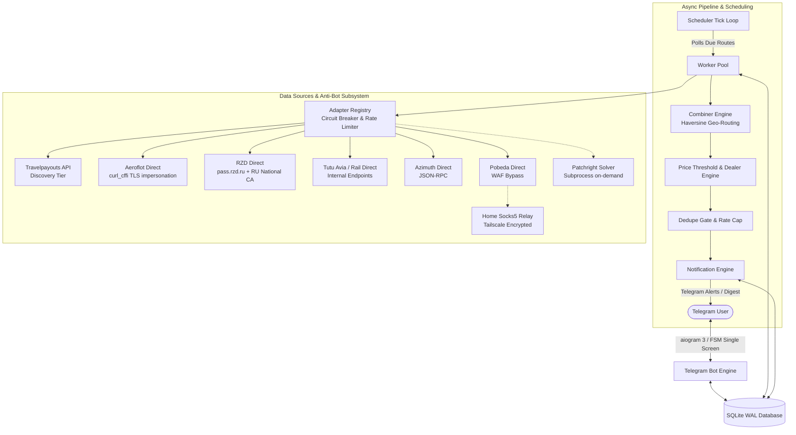

# Aviapars

Отказоустойчивый асинхронный сервис мониторинга цен на авиа- и ж/д-билеты с алгоритмическим подбором мультимодальных маршрутов через стыковочные хабы и защитой от антифрод-систем перевозчиков.

```
🔎 Екатеринбург → Сочи
29.09.2026

Нашёл вариантов: 12. Показываю 5 самых дешёвых:

1️⃣ 6 101 ₽ · 29.09.2026 · ✈️ · 4ч ⚠️
2️⃣ 6 859 ₽ · 29.09.2026 · ✈️ · 4ч ⚠️
3️⃣ 12 427 ₽ · 29.09.2026 · ✈️+✈️ через MOW · 18ч 40м ⚠️

✅ цена подтверждена перевозчиком · ⚠️ из кэша агрегатора
Проверено дат: 1.
       [💾 Следить за №1] [💾 Следить за №2] [🔎 Новый поиск] [☰ Меню]

... переход в мастер добавления маршрута без создания новых сообщений:

➕ Новый маршрут
Екатеринбург → Сочи · ✈️ Самолёт · 25.09.2026 – 05.10.2026 (11 дн.)

Как часто проверять цену?
Число минут, не меньше 15 — обычно хватает 60.

... целевой алерт при фиксации цены ниже установленного порога:

🔥 Екатеринбург → Сочи
💰 6 101 ₽ · порог 8 000 ₽
🗓 29.09.2026 · ✈️

✈️ SVX → AER
🕑 вылет 09:20 · прибытие 13:30 · в пути 4ч 10м
🎫 Россия · рейс 6565

⚠️ Не подтверждено · данные 2 ч назад
⚠️ 6 101 ₽ · купить у Travelpayouts
✅ 6 750 ₽ · купить у Аэрофлот
```

---

## Problem & Context

1. **Недостоверность агрегаторов и агрессивный антифрод перевозчиков**:
   - Популярные метапоисковики и OTA отдают закэшированные данные с отставанием от 2 до 6 часов. К моменту перехода по ссылке дешевый тариф часто уже выкуплен.
   - Прямой скрейпинг сайтов авиакомпаний (Аэрофлот, Победа, S7, Азимут) и РЖД сопряжен с постоянным противодействием защитным системам: WAF (Cloudflare, ServicePipe, Qrator), валидация TLS/JA3-отпечатков, проверка принадлежности IP к датацентрам, шифрованные сессионные подписи и JavaScript-челленджи.

2. **Жесткие ресурсные ограничения продакшна**:
   - Сервис спроектирован для бесперебойной работы на бюджетных VDS с конфигурацией **1 vCPU / 1 GB RAM (Ubuntu 24.04)**.
   - Полноценные пулы браузеров (Headless Chromium через Playwright/Puppeteer) в режиме 24/7 потребляют от 600 МБ до 1.5 ГБ RAM и моментально утилизируют 100% CPU на слабом инстансе, приводя к OOM-киллам. Архитектура требовала сведения тяжелых браузерных процессов к кратковременным, строго изолированным разовым вызовам.

3. **Сложная география и отсутствие мультимодальности**:
   - Традиционные билетные поисковики не умеют эффективно стыковать авиа- и ж/д-сегменты в единый маршрут и ограничены тривиальным перебором московского авиаузла. На маршрутах между регионами (например, Урал — Кавказ или Сибирь — Поволжье) оптимальный пересадочный хаб нередко лежит в Самаре, Казани или Волгограде.

---

## Solution & Key Features

### 1. Zero-Flood Telegram Interface («Один экран на чат»)
- **Реактивное FSM-взаимодействие (aiogram 3)**: бот не засоряет историю диалога десятками сообщений на каждый шаг диалога. Интерфейс фиксируется на одном якорном сообщении (`anchor_id`), которое динамически обновляется (`edit_message_text`) по мере выбора фильтров, городов и дат.
- **Автоматическая зачистка пользовательского ввода**: отправленный пользователем произвольный текст (названия городов, интервалы, пороги) удаляется ботом сразу после успешного разбора.
- **Дедупликация и умная доставка алертов**:
  - Предложения из разных источников на один и тот же физический рейс объединяются в одну карточку с перечислением всех найденных цен и прямых ссылок на покупку.
  - Гибкая доставка: мгновенные уведомления (`⚡ Сразу`) или компактная сводная сводка за сутки (`📬 Раз в день`) без потери отдельных находок.
  - Полноценная поддержка тихих часов (`quiet hours`) и персонального времени дайджеста через `/settings`.

### 2. Гео-маршрутизация через хабы (формула гаверсинуса)
- **Умный выбор стыковочных узлов**: хабы ранжируются не по абстрактной популярности, а по минимальному угловому отклонению от геодезической траектории (ортодромии) между точкой отправления и назначения.
- **Мультимодальная комбинаторика**: поддержка связок «✈️ Самолёт + ✈️ Самолёт», «✈️ Самолёт + 🚂 Поезд», «🚂 Поезд + ✈️ Самолёт» и «🚂 Поезд + 🚂 Поезд».
- **Защита стыковок**: строгий учет минимального времени на пересадку (трансфер) и ограничение суммарного времени в пути для отсечения нереалистичных маршрутов.

### 3. Отказоустойчивый сетевой пайплайн и обход антифрода
- **TLS Fingerprint Emulation**: интеграция `curl_cffi` с подменой TLS/JA3-хэндшейка и HTTP/2-заголовков для эмуляции реального десктопного Chrome.
- **Многоуровневый EgressPool с липкой ротацией**:
  - Каскадная маршрутизация сетевых запросов: *Direct VDS IP → Локальный туннель / Bridge (SOCKS5/xray) → Домашний резидентный ISP-релей (Tailscale)*.
  - Адаптер запоминает последний успешный выход и не долбится повторно в заблокированный эндпоинт.
- **Circuit Breaker & Adaptive Rate Limiting**:
  - Изолированные Leaky Bucket лимитеры на уровне каждого источника данных, предотвращающие лавинообразные всплески нагрузки.
  - Трехступенчатая лестница остывания (15 мин → 1 ч → 4 ч) при обнаружении HTTP 403/429.
- **Изолированный Patchright Solver**:
  - Для преодоления тяжелых антибот-челленджей (Group-IB / ServicePipe) используется отдельный subprocess, запускаемый строго on-demand.
  - Память демона защищена от утечек: процесс браузера завершается сразу после решения задачи и передает сессионные куки в постоянный пул SQLite.

---

## Architecture



### Архитектурные принципы сервиса
1. **Never-Raise Contract**: ни один адаптер внешнего источника не имеет права пробросить исключение наверх. Все сетевые сбои, таймауты и блокировки типизируются в результат `SearchResult` со статусами `OK`, `EMPTY`, `BLOCKED` или `UPSTREAM_ERROR`.
2. **SQLite в режиме WAL**: конкурентный доступ на чтение без блокировки пишущих транзакций, с настроенным `busy_timeout` и схемой версионирования через `schema_migrations`.
3. **Строгое разделение секретов и тюнинга**: конфиденциальные токены хранятся исключительно в `.env`, а тонкие параметры планировщика, лимитов и пулов прокси — в `config.yaml`.

Подробный разбор проектных решений и структуры базы данных — в [ARCHITECTURE.md](ARCHITECTURE.md).

---

## Testing & Quality

В проекте реализована строгая культура автоматизированного тестирования. Тестовый набор включает **320+ тестов** без обращений к реальной сети:

- **Fixtures на реальных дампах**: интеграционные тесты адаптеров выполняются на записанных ответах реальных API и HAR-архивов (Аэрофлот, РЖД, Туту, Азимут, Победа, Travelpayouts).
- **End-to-End Walking Skeleton**: тестирование сквозных сценариев (постановка в очередь, опрос источников, дедупликация, генерация карточки и отправка алерта).
- **Stress & Flood Scenarios**: тесты обработки некорректного ввода, восстановления якорного экрана после серий нотификаций и граничных случаев расчета геодезических расстояний.
- **Статический анализ**: 100% аннотация типов и строгая проверка `mypy --strict src` в целевом Linux-окружении.

Запуск тестового набора:
```bash
pytest
```

Проверка строгой типизации:
```bash
mypy --strict src
```

---

## Quickstart & Deployment

### Вариант 1. Локальный запуск

**Требования**: Python 3.12+, git.

```bash
# 1. Клонирование репозитория
git clone <repo-url> aviapars
cd aviapars

# 2. Создание и активация виртуального окружения
python -m venv .venv
# Linux / macOS:
source .venv/bin/activate
# Windows:
# .\.venv\Scripts\Activate.ps1

# 3. Установка зависимостей
pip install -e ".[dev]"

# 4. Конфигурация окружения
cp .env.example .env
cp config.example.yaml config.yaml
# Заполните TELEGRAM_BOT_TOKEN и ADMIN_TG_ID в .env

# 5. Применение миграций и сидирование справочника мест
python -m aviapars.db.migrate
python data/seed_places.py

# 6. Запуск сервиса
python -m aviapars
```

### Вариант 2. Развертывание в Docker

В репозитории подготовлены `Dockerfile` и `docker-compose.yml`:

```bash
# Подготовка файлов конфигурации
cp .env.example .env
cp config.example.yaml config.yaml

# Запуск контейнера в фоне
docker compose up -d --build

# Просмотр логов
docker compose logs -f
```

### Вариант 3. Продакшн на VDS (Ubuntu 24.04 + systemd)

Сервис рассчитан на запуск под управлением `systemd` с cgroup-изоляцией ресурсов:

```bash
# Создание системного пользователя и директорий
sudo useradd -r -s /usr/sbin/nologin aviapars
sudo mkdir -p /opt/aviapars /var/lib/aviapars
sudo chown -R aviapars:aviapars /var/lib/aviapars

# Копирование репозитория в /opt/aviapars и настройка .env / config.yaml
sudo git clone <repo-url> /opt/aviapars
cd /opt/aviapars
sudo cp .env.example .env && sudo cp config.example.yaml config.yaml

# Установка systemd unit-файла
sudo cp deploy/aviapars.service /etc/systemd/system/
sudo systemctl daemon-reload
sudo systemctl enable aviapars

# Запуск деплой-скрипта
bash deploy/deploy.sh
```

Параметры безопасности в `deploy/aviapars.service`:
- `MemoryHigh=450M` / `MemoryMax=900M` — защита сервера от OOM.
- `ProtectSystem=strict` / `PrivateTmp=yes` — изоляция файловой системы.
- `Type=notify` — поддержка watchdog через `sd_notify`.

Подробная пошаговая инструкция по настройке свопа, Tailscale и Xray-прокси — в [deploy/INSTALL.md](deploy/INSTALL.md).

---

## Available Commands

| Команда | Доступ | Назначение |
|---|---|---|
| `/start` | Все | Первичный запуск, приветствие и открытие главного меню |
| `/menu` | Все | Вызов единого экрана главного меню |
| `/search` | Все | Интерактивный разовый поиск билетов с кнопкой «Отслеживать» |
| `/routes` | Все | Управление активными маршрутами, пауза, удаление, ручная проверка |
| `/settings` | Все | Настройка тихих часов (`quiet hours`) и времени отправки дайджеста |
| `/status` | Все | Состояние и статистика здоровья адаптеров источников данных |
| `/stop` | Admin | Экстренная остановка сервиса (без автоматического перезапуска) |
| `/pause_all` | Admin | Массовая пауза опроса всех маршрутов в базе данных |
| `/s7_session` | Admin | Ручная передача валидной сессии/кук для обхода антибота S7 |

---

## License

PolyForm Noncommercial License 1.0.0. См. [LICENSE](LICENSE) для подробностей.
